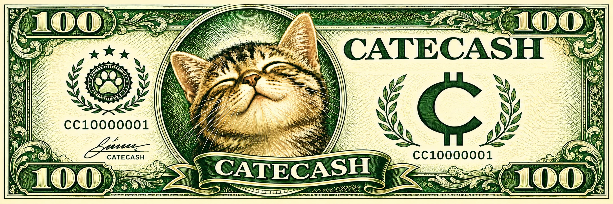
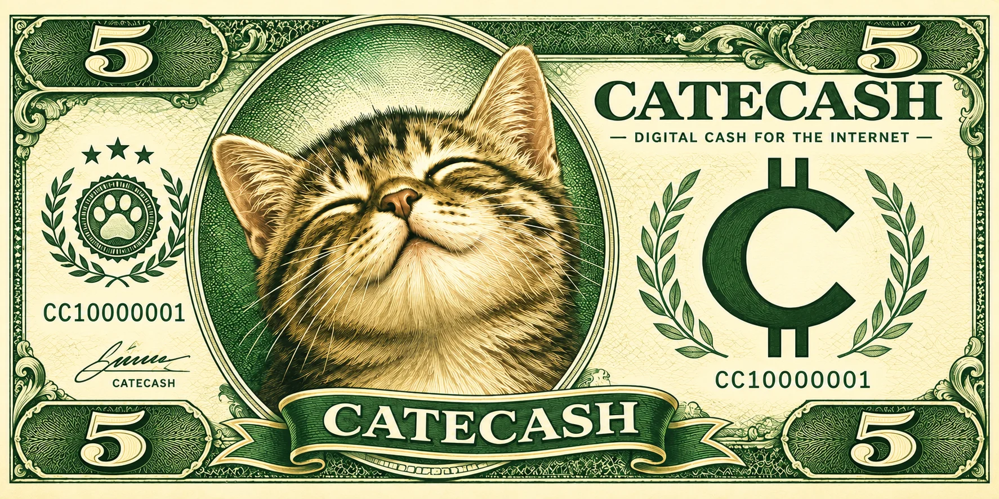
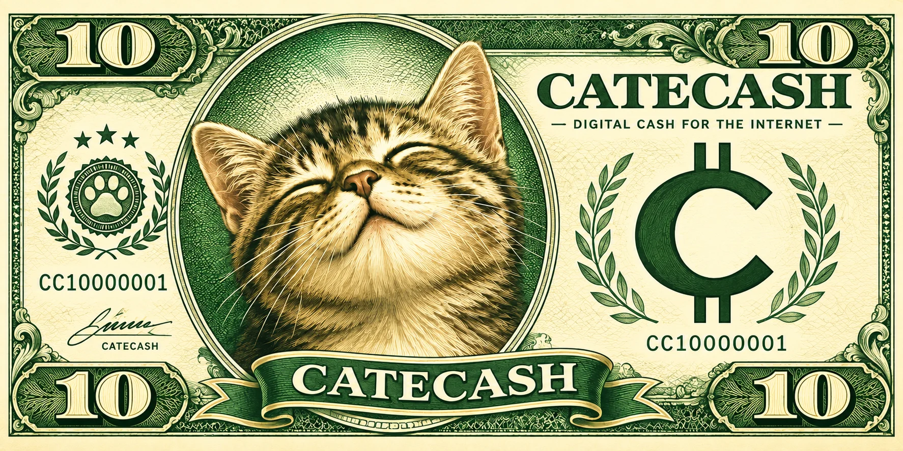

  

  <h1>doge &lt; catecash &gt; coin</h1>

  
<strong>A live, mineable digital currency built for open participation and privacy.</strong>

  

    <a href="https://catecash.com/"><strong>Explore the website</strong></a>
    &nbsp; · &nbsp;
    <a href="https://github.com/catecash/zebra">Explore the development fork</a>
    &nbsp; · &nbsp;
    <a href="https://x.com/catecash">Follow on X</a>
  

## Mainnet is live

Catecash mainnet mining has officially started.

Network ports are open.

iOS wallet submitted to Apple, awaiting approval.

Browser extension wallet developed.

Cross-chain swaps are next. Or maybe we just chill and let the network grow.

**Cate > Doge. Cash > Coin.**

## The idea

Catecash pairs ongoing miner rewards with Equihash proof of work and Zcash-derived privacy features. It runs as an **independent network**. Development continues in public.

<table>
  <tr>
    <td width="33%" align="center"> <strong>Open source</strong> Development happens in public.</td>
    <td width="33%" align="center"> <strong>Open participation</strong> Mainnet mining is underway.</td>
    <td width="33%" align="center"> <strong>Privacy</strong> Privacy features are part of the project.</td>
  </tr>
</table>

## Build in public

The [Catecash Zebra fork](https://github.com/catecash/zebra) is part of the public source code. The iOS wallet is awaiting Apple's approval, and a browser extension wallet has been developed. Cross-chain swaps are a possible next step as the network grows.

Catecash is independent and is not affiliated with or endorsed by Dogecoin, the Zcash Foundation, or Electric Coin Company. Applicable upstream licenses and attribution are preserved in the development repositories.

  <a href="https://catecash.com/"><strong>catecash.com</strong></a>
  &nbsp; · &nbsp;
  <a href="https://github.com/catecash/zebra">Source code</a>
  &nbsp; · &nbsp;
  <a href="https://x.com/catecash">Updates</a>

